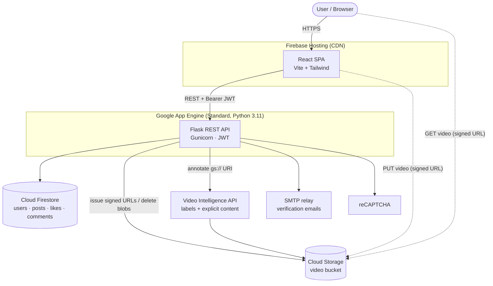
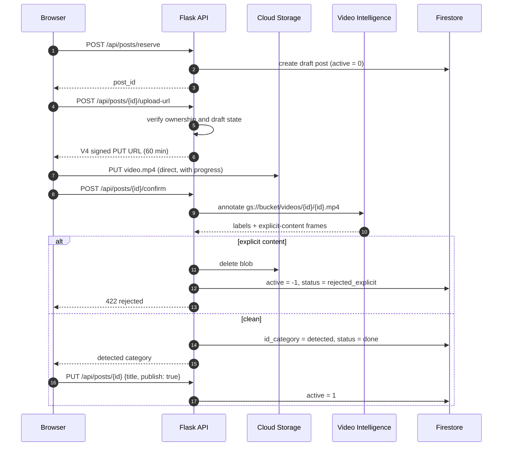

# 🎮 GameHub

**A cloud-native platform for sharing gaming clips, with AI-powered content moderation and automatic game categorization. Built end to end on Google Cloud Platform, with the infrastructure defined in Terraform.**


> **Note:** GameHub was a university project at WSB University. I designed and built all of it myself: frontend, backend, cloud infrastructure and deployment. The live deployment has been shut down to avoid cloud costs. The steps below show how to run it locally or deploy it to your own GCP project.

---

## Table of Contents

- [Overview](#overview)
- [Key Features](#key-features)
- [Architecture](#architecture)
- [Tech Stack](#tech-stack)
- [Engineering Highlights](#engineering-highlights)
- [Project Structure](#project-structure)
- [Getting Started (Local Development)](#getting-started-local-development)
- [Deploying to Google Cloud](#deploying-to-google-cloud)
- [Configuration Reference](#configuration-reference)
- [API Reference](#api-reference)
- [Data Model](#data-model)
- [Security](#security)
- [Troubleshooting](#troubleshooting)
- [Known Limitations & Roadmap](#known-limitations--roadmap)
- [What I Learned](#what-i-learned)
- [Author](#author)

---

## Overview

GameHub is a social feed where gamers upload short video clips (up to **150 MB**), browse clips from other players, like them and discuss them in the comments.

Every uploaded video goes through **Google Cloud Video Intelligence**:

1. **Explicit content detection** rejects inappropriate videos and deletes them from storage automatically.
2. **Label detection** assigns the clip to a game category such as *Counter-Strike*, *Minecraft*, *GTA* or *Valorant*, so uploaders never have to pick one by hand.

The project covers the whole lifecycle of a web product: a React SPA, a REST API, a NoSQL data model, object storage, infrastructure as code, and a hardened supporting VM.

<!--
## Screenshots
Add 2–3 screenshots or a short GIF here (e.g. docs/feed.png, docs/upload.gif).
-->

---

## Key Features

| Area | Feature |
|---|---|
| **Accounts** | Registration with a password strength policy, Google reCAPTCHA v2, email verification links that expire after 30 minutes, and JWT-based login |
| **Video upload** | Direct browser → Cloud Storage upload through **V4 signed URLs**, with a live progress bar and support for files up to 150 MB |
| **AI moderation** | Explicit content detection, with automatic rejection and deletion of offending videos |
| **AI categorization** | Video labels mapped to game categories (CS, GTA, LoL, Minecraft, Valorant, Fortnite, The Witcher, Cyberpunk, Forza, Roblox), with *Other* as a fallback |
| **Feed** | Paginated feed with filters for category, *liked by me* and *my posts* |
| **Social** | Likes (toggle) and comments (create, edit, delete your own) |
| **Content management** | Edit or delete your own posts. Abandoned draft uploads are cleaned up automatically |
| **Player** | Lazy video playback driven by `IntersectionObserver` |
| **Infrastructure** | All GCP resources are provisioned with Terraform, with remote state in GCS |

---

## Architecture



### Upload & moderation flow



The large video file never passes through the backend. App Engine has request size and timeout limits, so the browser uploads straight to Cloud Storage with a short-lived signed URL. The API only coordinates the process.

---

## Tech Stack

### Frontend
| Technology | Purpose |
|---|---|
| **React 18** | UI library |
| **Vite 5** | Dev server & bundler |
| **Tailwind CSS 3** | Utility-first styling with a custom dark "hub" theme |
| **React Router 6** | Client-side routing |
| **Axios** | HTTP client with interceptors that attach the JWT and handle 401 responses |
| **Framer Motion** | Animations |
| **Radix UI**, **lucide-react** | Accessible primitives & icons |
| **react-google-recaptcha** | Bot protection on sign-up |

### Backend
| Technology | Purpose |
|---|---|
| **Python 3.11 / Flask 3** | REST API |
| **Gunicorn** | Production WSGI server |
| **PyJWT** | Stateless auth tokens (HS256, 7-day expiry) |
| **bcrypt** | Password hashing (cost factor 12) |
| **google-cloud-firestore / -storage / -videointelligence** | GCP SDKs |

### Cloud & DevOps
| Technology | Purpose |
|---|---|
| **Google App Engine (Standard)** | Autoscaling backend hosting that scales to zero |
| **Firebase Hosting** | Global CDN + TLS for the SPA |
| **Cloud Firestore** | Serverless NoSQL database |
| **Cloud Storage** | Video storage, with a CORS policy and a 365-day lifecycle rule |
| **Video Intelligence API** | ML-based moderation & categorization |
| **Secret Manager** | Storage for the Flask secret key |
| **Compute Engine + IAP** | Hardened mail-relay VM (Postfix, UFW, Fail2ban) reachable over SSH only through Identity-Aware Proxy |
| **Terraform** | Infrastructure as Code with a versioned remote state bucket |

---

## Engineering Highlights

Some of the more interesting problems I solved along the way:

- **Direct-to-storage uploads with signed URLs.** App Engine limits request size and duration. The API issues a **V4 signed URL** scoped to a single object, HTTP method and content type, and the browser uploads straight to GCS. This keeps backend instances light and allows 150 MB uploads.
- **Signing URLs without a key file.** App Engine's default service account has no private key, so the backend signs URLs through the **IAM `signBlob` API**, using the runtime's access token and `roles/iam.serviceAccountTokenCreator`. No credential files are shipped with the app.
- **Draft/reservation pattern.** A post is *reserved* (inactive) before the upload starts, which gives the video a stable storage path (`videos/{id}/{id}.mp4`). If the user closes the modal or the tab, the draft and its blob are cleaned up through `/cancel` and a `beforeunload` hook.
- **Moderation gate.** The publish endpoint requires the post to have passed analysis (`analysis_status = done`). Clients can't skip `/confirm` or re-activate a rejected video.
- **Race-free auto-increment IDs in Firestore.** Sequential IDs come from a counter document updated inside a **Firestore transaction**, so concurrent requests can't receive the same ID.
- **Transparent password-hash migration.** An earlier version stored salted SHA-256 hashes. The login flow still accepts them and **re-hashes them to bcrypt** on the next successful login, so no password reset was needed.
- **Defense in depth on the data layer.** Firestore security rules deny all direct client access. All reads and writes go through the API, which checks ownership on every mutating endpoint.
- **Hardened VM via Terraform.** The mail VM has no public SSH. Port 22 is open only to Google's IAP range (`35.235.240.0/20`), the OS firewall (UFW) mirrors the cloud firewall rules, and Fail2ban protects SSH and Postfix. Access is granted per user through an IAM binding.
- **Fail-safe configuration.** The backend refuses to start on App Engine without a `SECRET_KEY`. Locally, if SMTP isn't configured, verification links are printed to the logs so the app stays usable without an email provider.

---

## Project Structure

```
.
├── backend/
│   ├── main.py                  # Flask app: auth, posts, likes, comments, moderation
│   ├── requirements.txt
│   ├── firestore.rules          # Deny-all rules (API is the only gateway)
│   └── firestore.indexes.json   # Composite indexes
│
├── frontend/
│   ├── src/
│   │   ├── components/          # PostCard, VideoPlayer, AddPostModal, CommentsSection, TopNav, ...
│   │   ├── context/AuthContext.jsx   # Global auth state (JWT)
│   │   ├── pages/               # Home (feed), Login, Register, Verify
│   │   ├── utils/api.js         # Axios instance + interceptors
│   │   └── App.jsx              # Routes
│   ├── .env.example
│   ├── firebase.json            # Hosting config (SPA rewrites)
│   └── vite.config.js           # Dev proxy → local Flask
│
├── terraform/
│   ├── main.tf                  # Provider + GCS remote state backend
│   ├── apis.tf                  # Enabled GCP APIs
│   ├── resources.tf             # Firestore, buckets, App Engine, Secret Manager, IAM
│   ├── mail_server.tf           # Hardened Compute Engine VM, firewall rules, IAP
│   ├── variables.tf / outputs.tf
│   └── terraform.tfvars.example
│
├── app.example.yaml             # App Engine config template (copy to app.yaml)
├── cors.json                    # CORS policy for the video bucket
└── requirements.txt             # Root copy for App Engine deploys from repo root
```

---

## Getting Started (Local Development)

### Prerequisites

- **Node.js** 18+ and npm
- **Python** 3.11+
- **Google Cloud SDK** (`gcloud`)
- A **GCP project** with Firestore (Native mode) and a Cloud Storage bucket. You can create both with [Terraform](#1-provision-infrastructure-with-terraform).

The backend talks to real Firestore and Cloud Storage even locally. There is no emulator setup.

### 1. Clone the repository

```bash
git clone https://github.com/<your-username>/gamehub.git
cd gamehub
```

### 2. Authenticate with Google Cloud

```bash
gcloud auth login
gcloud config set project <YOUR_PROJECT_ID>
gcloud auth application-default login   # credentials for the Python SDKs
```

### 3. Run the backend

```bash
cd backend
python -m venv venv
# Windows: venv\Scripts\activate   |   macOS/Linux: source venv/bin/activate
pip install -r requirements.txt

# Minimal local configuration (PowerShell: $env:GCS_BUCKET="...")
export GOOGLE_CLOUD_PROJECT=<YOUR_PROJECT_ID>
export GCS_BUCKET=<YOUR_PROJECT_ID>-videos
export FLASK_DEBUG=1

python main.py        # → http://localhost:8080
```

> Without `SMTP_USER`/`SMTP_PASSWORD`, the email verification link is **printed to the console**. Open it in the browser to activate the account.
>
> Signed URLs are issued for `<PROJECT_ID>@appspot.gserviceaccount.com`. Your local account needs the **Service Account Token Creator** role on that service account (see [Troubleshooting](#troubleshooting)).

### 4. Run the frontend

```bash
cd frontend
npm install
npm run dev           # → http://localhost:5173
```

The Vite dev server proxies `/api/*` to `http://localhost:8080`. You can change the target with `VITE_PROXY_TARGET` in `frontend/.env.local`.

---

## Deploying to Google Cloud

### 1. Provision infrastructure with Terraform

```bash
cd terraform
cp terraform.tfvars.example terraform.tfvars   # fill in project_id, secret, IAP email
# Place a service-account key at ./credentials.json (git-ignored)

terraform init
terraform plan
terraform apply
```

On the very first run, comment out the `backend "gcs"` block in `main.tf`, because the state bucket doesn't exist yet. Once it has been created, restore the block and run `terraform init -migrate-state`. See [`terraform/README.md`](terraform/README.md) for details.

Terraform enables the required APIs and creates:

| Resource | Name |
|---|---|
| Firestore (Native) | `(default)` |
| Storage bucket (videos) | `<project>-videos`, with CORS + 365-day lifecycle |
| Storage bucket (TF state) | `<project>-terraform-state`, versioned |
| App Engine application | `<project>.appspot.com` |
| Secret Manager secret | `flask-secret-key` |
| IAM | App Engine SA → `storage.objectAdmin` on the video bucket |
| Compute Engine VM | `gamehub-mail-server` (e2-micro, static IP, IAP-only SSH) |

Then apply the bucket CORS policy and the Firestore configuration:

```bash
gcloud storage buckets update gs://<PROJECT_ID>-videos --cors-file=cors.json
```

- **Rules:** publish `backend/firestore.rules` (Firebase console → Firestore → Rules, or add a `firestore` section to `firebase.json` and run `firebase deploy --only firestore`).
- **Indexes:** create the composite indexes from `backend/firestore.indexes.json`. Firestore also prints a direct "create index" link the first time a query needs one.

### 2. Deploy the backend (App Engine)

```bash
cp app.example.yaml app.yaml   # fill in real values. app.yaml is git-ignored
gcloud app deploy app.yaml
gcloud app logs tail -s default   # stream logs
```

### 3. Deploy the frontend (Firebase Hosting)

```bash
cd frontend
echo "VITE_API_URL=https://<PROJECT_ID>.appspot.com/api" > .env.production
npm run build
firebase use <PROJECT_ID>
firebase deploy --only hosting
```

Remember to add the frontend's domain to the CORS origins in `backend/main.py` and in `cors.json`.

---

## Configuration Reference

### Backend environment variables

| Variable | Required | Description |
|---|---|---|
| `SECRET_KEY` | **Yes** (prod) | JWT signing key. The app refuses to start on App Engine without it |
| `GCS_BUCKET` | Yes | Name of the video bucket |
| `GOOGLE_CLOUD_PROJECT` | Locally | GCP project ID (set automatically on App Engine) |
| `FRONTEND_URL` | Yes | Base URL used in verification emails |
| `SMTP_HOST` / `SMTP_PORT` | No | SMTP relay (default `smtp-relay.brevo.com:587`) |
| `SMTP_USER` / `SMTP_PASSWORD` | No* | SMTP credentials. *Without them, emails are logged instead of sent |
| `SMTP_FROM` | No | Sender header |
| `RECAPTCHA_SECRET` | No | When set, a valid reCAPTCHA token is **required** to register |
| `FLASK_DEBUG` | No | `1` enables Flask debug mode for local runs |

### Frontend environment variables

| Variable | Description |
|---|---|
| `VITE_API_URL` | API base URL baked into the production build (defaults to `/api`) |
| `VITE_PROXY_TARGET` | Dev-server proxy target (defaults to `http://localhost:8080`) |

---

## API Reference

All endpoints are prefixed with `/api`. Authenticated endpoints expect `Authorization: Bearer <JWT>`.

### Auth
| Method | Endpoint | Auth | Description |
|---|---|:-:|---|
| `POST` | `/auth/register` | – | Create an account (email, nick, password, reCAPTCHA token) |
| `GET` | `/auth/verify?code=&user_id=` | – | Verify email address |
| `POST` | `/auth/login` | – | Returns a JWT + user profile |
| `POST` | `/auth/logout` | – | Stateless logout (the client discards the token) |
| `GET` | `/auth/me` | ✅ | Current user |

### Posts
| Method | Endpoint | Auth | Description |
|---|---|:-:|---|
| `GET` | `/posts?page=&category_id=&liked=&my=` | optional | Paginated feed (10 per page) with signed read URLs |
| `POST` | `/posts/reserve` | ✅ | Create a draft post, returns `post_id` |
| `POST` | `/posts/{id}/upload-url` | ✅ | Signed PUT URL for the draft's video (owner only) |
| `POST` | `/posts/{id}/confirm` | ✅ | Run AI moderation + categorization |
| `PUT` | `/posts/{id}` | ✅ | Update title/description, or publish (`publish: true`) |
| `DELETE` | `/posts/{id}` | ✅ | Delete post with its video, likes and comments |
| `DELETE` | `/posts/{id}/cancel` | ✅ | Discard an unpublished draft |

### Social & misc
| Method | Endpoint | Auth | Description |
|---|---|:-:|---|
| `GET` | `/categories` | – | List categories |
| `POST` | `/posts/{id}/like` | ✅ | Toggle like |
| `GET` | `/posts/{id}/comments` | – | List comments |
| `POST` | `/posts/{id}/comments` | ✅ | Add comment |
| `PUT` | `/posts/{id}/comments/{cid}` | ✅ | Edit own comment |
| `DELETE` | `/posts/{id}/comments/{cid}` | ✅ | Delete own comment |
| `GET` / `POST` | `/casino/state`, `GET /casino/leaderboard` | ✅ / – | Experimental mini-game API (the frontend isn't part of this repo) |

---

## Data Model

Firestore collections. Documents are keyed by sequential numeric IDs from the transactional `counters` collection.

```text
users            { id, email, password (bcrypt), nick, verified: 0|1, created_at }
posts            { id, id_user, id_category, video_location, thumbnail_location,
                   title, description, post_datetime, like_count,
                   active: -1|0|1, analysis_status: pending|done|rejected_explicit }
categories       { id, category_name }
likes            { id, id_user, id_post }
comments         { id, id_post, id_user, content, comment_datetime, author_nick }
temp_auth_codes  { id, id_user, code, expires_at }
counters         { value }   // one document per collection
```

Storage layout: `videos/{post_id}/{post_id}.mp4`

---

## Security

- Passwords hashed with **bcrypt** (12 rounds). Strength policy enforced on both client and server.
- **JWT** (HS256) with expiry. The secret is supplied through the environment and never committed.
- **Ownership checks** on every mutating endpoint (posts, uploads, comments).
- **Signed URLs** with short lifetimes (60 min upload, 1 h read). The bucket uses uniform bucket-level access and is not public.
- **Firestore rules** deny all direct client access.
- **reCAPTCHA** on registration. Email verification codes come from `secrets.token_urlsafe` and expire after 30 minutes.
- **CORS** allow-lists on both the API and the bucket.
- **Infrastructure:** IAP-only SSH, layered firewalls (VPC + UFW), Fail2ban, least-privilege IAM bindings, versioned Terraform state.
- All secrets (`app.yaml`, `terraform.tfvars`, `credentials.json`, `.env*`) are git-ignored, and committed templates contain placeholders only.

---

## Troubleshooting

| Symptom | Cause & fix |
|---|---|
| `You need a private key to sign credentials` | The identity running the backend can't sign as the App Engine SA. Grant it **Service Account Token Creator**:<br/>`gcloud iam service-accounts add-iam-policy-binding <PROJECT_ID>@appspot.gserviceaccount.com --member="user:<you>" --role="roles/iam.serviceAccountTokenCreator"` (on App Engine, use `serviceAccount:<PROJECT_ID>@appspot.gserviceaccount.com` as the member) |
| CORS error in the browser | Add the frontend origin to `CORS(origins=[...])` in `backend/main.py` and, for uploads, to `cors.json`, then re-apply it to the bucket |
| Upload fails at 0% | The bucket's CORS policy is missing, or the file isn't `.mp4` / exceeds 150 MB |
| Backend crashes on App Engine start | `SECRET_KEY` isn't set in `app.yaml` |
| `401 Unauthorized` after refresh | The JWT expired (7 days). Log in again |
| Query error `requires an index` | Create the composite index (see `firestore.indexes.json` or the link in the error) |
| Terraform: `API not enabled` | Enable the Cloud Resource Manager API (link in the error), wait a minute and re-run |

---

## Known Limitations & Roadmap

This was a time-boxed student project. These are the things I would improve next:

- [ ] **Automated tests & CI/CD.** Pytest for the API, Vitest for the UI, and a GitHub Actions pipeline running `terraform plan` and deploys.
- [ ] **Feed scalability.** The feed currently loads all active posts and filters in memory, with per-post author/like lookups (N+1). Next step: Firestore cursor pagination with the existing composite indexes, plus denormalized author nicks.
- [ ] **Async video analysis.** `/confirm` blocks while Video Intelligence runs. Next step: move it to a Cloud Tasks / Pub/Sub worker triggered by a GCS upload event.
- [ ] **Thumbnails.** The thumbnail path is reserved, but thumbnails aren't generated yet (planned: Cloud Function + ffmpeg).
- [ ] **Secret Manager at runtime.** Read `SECRET_KEY` from Secret Manager (it is already provisioned) instead of `app.yaml` env vars.
- [ ] **Token storage.** Move the JWT from `localStorage` to an `HttpOnly` cookie, and add rate limiting on the auth endpoints.
- [ ] **Mini-game integrity.** The experimental casino endpoints trust client-reported balances. Game logic should run server-side.
- [ ] **Self-hosted mail relay.** The Postfix VM is provisioned and hardened, but production email goes through Brevo. SASL auth and proper TLS certificates are still needed.
- [ ] **i18n.** The UI and API messages are currently in Polish only.

---

## What I Learned

- Designing around **serverless platform limits** (request size, timeouts, keyless service accounts) instead of fighting them.
- Writing **Terraform** for a real project: API enablement ordering, remote state bootstrapping, and IAM bindings.
- Integrating **ML APIs** into a product flow and handling their failure modes. If analysis fails, the clip falls back to the *Other* category and the upload isn't blocked.
- Modeling relational-style data in a **document database**: composite indexes, transactional counters and denormalization trade-offs.
- Doing **security reviews of my own code**: ownership checks, moderation bypasses, secret handling and migrating legacy password hashes.

---

## Author

**Jakub Chrzanowski**: design, frontend, backend, cloud infrastructure and deployment.

<!-- Add your links: -->
<!-- [LinkedIn](https://www.linkedin.com/in/...) · [GitHub](https://github.com/...) -->
